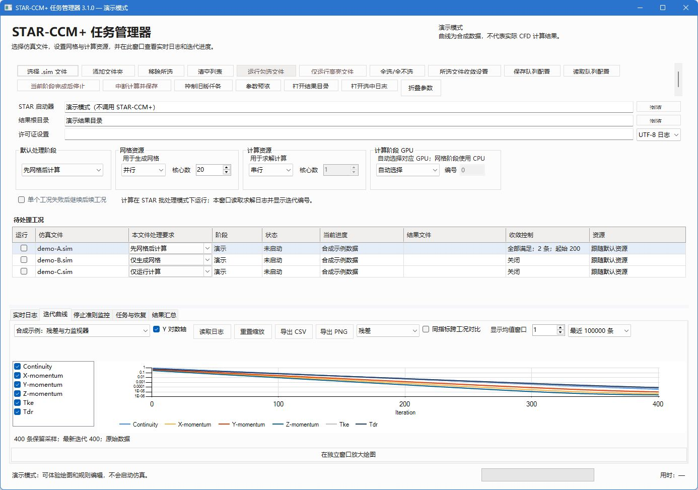
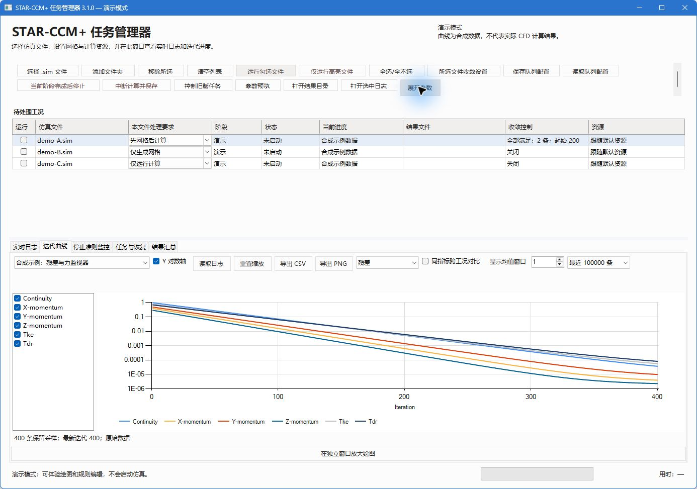

# STAR-CCM+ 任务管理器

Windows 桌面工具，用于批量生成体网格、运行计算、监控进度、绘制日志曲线，以及按自定义规则请求停止和保存。

**[下载最新版](https://github.com/z10-01z/starccm-task-manager/releases/latest)** · [使用说明](USER_GUIDE.md) · [更新记录](CHANGELOG.md) · [反馈问题](https://github.com/z10-01z/starccm-task-manager/issues)

本仓库提供软件发布、使用文档和问题反馈。下载完整 ZIP，解压后运行 `StarCcmTaskManager.exe`。

## 功能

- 仅运行勾选或高亮的文件，逐文件选择仅网格、仅计算或先网格后计算。
- 分别配置网格和计算的串行/本地并行、核心数与求解 GPU 参数。
- 显示任务阶段、日志迭代、运行时间及可用的资源信息。
- 绘制实时与历史日志曲线，导出 CSV/PNG，保存和读取绘图视图。
- 按步数、阈值、窗口波动或趋势组合停止规则，提供规则模板和历史回放。
- 手动中断计算并保存、定期检查点、未完成任务恢复、后台重连。
- 重开后查看历史任务；结果文件夹提供完成、失败、中断保存等中文状态说明。

## 快速开始

1. 安装并确认本机 STAR-CCM+ 可以正常运行。
2. 下载并完整解压软件 ZIP，打开程序。
3. 选择本机 STAR 安装目录的 `star/bin/starccm+.bat`、待处理 `.sim` 和结果目录。
4. 逐文件设置处理阶段及资源，核对运行前检查后启动。
5. 需要停止时点击“中断计算并保存”，等待保存确认。

自动停止和定期检查点默认关闭，需要时自行配置。关闭监控窗口后后台计算可以继续；计算机仍须保持开机，不能进入休眠。

## 环境与范围

Windows 10/11 x64、.NET Framework 4.8，以及自行安装并授权的 Simcenter STAR-CCM+。NVIDIA 资源监控依赖驱动附带的 `nvidia-smi`；求解 GPU 的可用性还取决于 STAR 版本、模型、硬件和许可。

3.2.1 已验证 STAR 20.06.010-R8 下独立小型稳态 CPU 工况的网格、停止保存、重开续算和后台恢复流程。GPU、瞬态、其他 STAR 版本、大型模型及物理高 DPI 未完成同范围验证。请求停止的步数可能早于实际保存步数，规则满足也不等于工程准确性已经确认。

## 界面预览

截图为 3.1.0 演示模式的合成数据，不代表 CFD 计算结果。可用 `StarCcmTaskManager.exe --demo` 体验界面，演示模式不会启动求解器。

这是独立工具，与 Siemens 无隶属或认证关系。本仓库不提供求解器、许可证或仿真模型。许可文本见 [LICENSE](LICENSE)。
